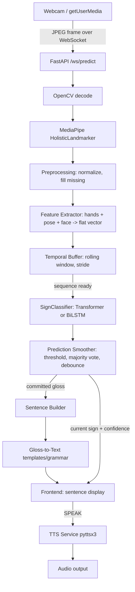

# SIGN-X — Architecture

## Pipeline overview

## Component responsibilities

| Component | File | Responsibility |
|---|---|---|
| Camera capture | frontend `CameraView.tsx` (browser `getUserMedia`) | Grabs webcam frames in the browser and streams them to the backend over WebSocket as JPEG bytes. The backend never opens the OS camera device directly in the deployed flow — `app/vision/camera.py` exists for local/offline tooling (training-time video reading uses OpenCV directly instead). |
| Landmark extraction | `app/vision/landmarks.py` | Wraps MediaPipe's Tasks `HolisticLandmarker` (hands + pose + face in one pass). Returns `None` per group when not detected — never raises on a bad/empty frame. |
| Preprocessing | `app/vision/preprocessing.py` | Translation + scale normalization (relative to shoulder midpoint), missing-landmark zero-fill, temporal pad/truncate, velocity computation. |
| Feature extraction | `app/vision/feature_extractor.py` | Single place that turns one frame into the flat feature vector consumed everywhere else (real-time inference *and* offline training extraction), so train/serve feature computation can never drift apart. |
| Temporal buffer | `app/inference/temporal_buffer.py` | Rolling window of the last `SEQUENCE_LENGTH` frames; a configurable `STRIDE` controls how often inference actually runs. |
| Models | `app/models/transformer.py`, `app/models/bilstm.py` | Temporal Transformer (primary) and BiLSTM (baseline) sequence classifiers, both `(batch, seq_len, feature_dim) -> (batch, num_classes)`. |
| Model loading | `app/models/model_loader.py` | Loads a trained checkpoint once at startup; falls back to an explicitly-flagged untrained demo model if none exists yet. |
| Smoothing | `app/inference/smoothing.py` | Confidence threshold -> UNKNOWN, majority voting over a short window, debounce so a held sign doesn't spam repeated commits. |
| Sentence building | `app/language/sentence_builder.py`, `gloss_to_text.py`, `vocabulary.py` | Accumulates committed glosses, applies phrase templates / a small SOV->SVO grammar heuristic, and renders punctuated English text. Explicitly **not** a full MT system (see Limitations). |
| Speech | `app/speech/tts.py` | `TTSService` interface with a local/offline `pyttsx3` implementation; swappable without touching callers. |
| Real-time orchestration | `app/inference/predictor.py` | Wires all of the above into one `process_frame()` call per WebSocket connection, with its own temporal state. |
| API | `app/api/*.py` | REST: health, model info/reload, dataset info. WebSocket: `/ws/predict` real-time protocol. |
| Training (manual datasets) | `backend/training/*.py` | `extract_landmarks.py` -> `prepare_dataset.py` -> `train.py` -> `evaluate.py`, all driven by `training/config.yaml`. For a folder-of-videos dataset with no official split. |
| Training (adapter-driven, real datasets) | `backend/training/datasets/{base,include,isl_csltr,registry}.py`, `dataset_report.py`, `visualize_landmarks.py`, `build_dataset_from_adapter.py` | Converts a specific dataset's own layout/metadata (e.g. INCLUDE's HuggingFace parquet + Zenodo videos) into the common `DatasetSample` representation, preserving the dataset's official train/val/test split. Reuses the exact same `extract_video()`/`FeatureExtractor` as the manual path — see "Train/serve parity" below. |

## Continuous recognition (Stage 7+)

The current pipeline is isolated-sign-first: one sliding window -> one
prediction -> smoothing -> commit. The same building blocks extend to
continuous signing without a rewrite:

1. `TemporalBuffer` already slides continuously — it doesn't require a
   "start/stop" signal.
2. `PredictionSmoother`'s debounce logic already acts as a coarse activity
   segmenter (a run of confident, stable predictions == one "segment").
3. `SentenceBuilder` already accumulates a *sequence* of committed glosses,
   not just the latest one.
4. A dedicated segmentation model (e.g. a binary "signing / not signing"
   detector, or blank-frame CTC-style detection) can be inserted between
   the temporal buffer and the classifier later, replacing the current
   confidence-based heuristic, without changing any other module's
   interface.

## Why MediaPipe Tasks (not `mp.solutions`)

Recent MediaPipe releases removed the legacy `mp.solutions.hands` /
`.pose` / `.face_mesh` Python API entirely in favor of the Tasks API
(`mediapipe.tasks.python.vision`). SIGN-X targets the current API and uses
`HolisticLandmarker`, which detects hands + pose + face in a single model
pass — matching exactly the feature groups Section 7 asks for. The model
asset (`holistic_landmarker.task`) is Google's official, publicly hosted
MediaPipe Tasks model (see `scripts/download_models.ps1`), not a custom or
invented file.

## Train/serve parity

`app/vision/feature_extractor.py` is imported by **both**
`training/extract_landmarks.py` (offline) and `app/inference/predictor.py`
(real-time). This guarantees the exact same normalization, landmark
selection and (optional) velocity computation is used at training time and
at inference time — a common source of silent accuracy loss in ML systems
that this design avoids by construction.

## Real-dataset adapters

`training/datasets/base.py` defines a tiny interface — `DatasetAdapter.list_samples()`
returns a flat list of `DatasetSample(sample_id, video_path, label, split, signer_id)`
records — so everything downstream (`dataset_report.py`, `visualize_landmarks.py`,
`build_dataset_from_adapter.py`) is completely agnostic to a specific
dataset's own directory/metadata layout. `training/datasets/include.py` is
the first real implementation (INCLUDE, via its HuggingFace parquet
metadata + Zenodo-hosted videos); `training/datasets/registry.py` maps an
experiment config's `dataset.adapter:` name to the right adapter class.
Adding support for a new dataset means writing one more adapter, not
modifying the training loop, the models, or the inference pipeline. See
`docs/dataset.md` for the concrete dataset this was exercised against.

## Limitations (read before drawing conclusions from this project)

- ISL grammar (topic-comment structure, spatial referencing, and
  grammatically meaningful facial expressions/eyebrow movement) is far
  richer than a fixed vocabulary + template sentence builder can capture.
  `gloss_to_text.py` is a small convenience layer, not a linguistic MT system.
- A 20-word vocabulary is a *starting point* for validating the pipeline,
  not a claim of general ISL translation.
- Landmark quality depends heavily on lighting, camera angle, and distance
  from camera; MediaPipe will silently return `None` for undetected groups.
- Different signers sign the same word differently; a model trained on a
  handful of signers will not generalize perfectly to a new signer without
  more data or signer-adaptation techniques (see Future Extensions).
- Continuous sentence recognition (Stage 7+) is substantially harder than
  isolated-sign classification and is provided here as an extensible
  architecture, not a finished continuous-ISL translator.
- No accuracy/F1 numbers are claimed anywhere in this repository unless
  they come from `training/evaluate.py` run against a real trained
  checkpoint and a real dataset split — see `docs/model.md`.
